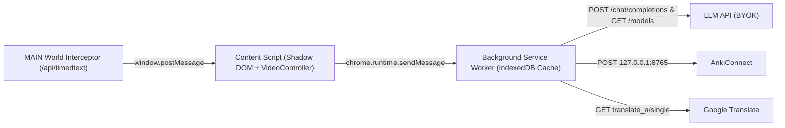

# YouTube Lang AI

A clean, distraction-free Chrome Extension (Manifest V3) for learning foreign languages directly on YouTube using bilingual clickable subtitles, Active Listening mode, contextual AI breakdowns (BYOK), and FSRS spaced-repetition flashcards.

[](https://developer.chrome.com/docs/extensions/mv3/intro/)
[](https://www.typescriptlang.org/)
[](https://react.dev/)
[](https://tailwindcss.com/)
[](https://github.com/open-spaced-repetition/ts-fsrs)
[](./LICENSE)

---

## Key Features

- **Bilingual Clickable Subtitles:** Isolated Shadow DOM HUD mounted directly inside `#movie_player` (survives Fullscreen mode, prevents YouTube CSS leakage, automatically hides during `.ad-showing` / `.ad-interrupting` ads, and merges fragmented YouTube ASR captions into readable sentences).
- **Two-Tier Translation & Contextual AI (BYOK):** Instant dictionary lookup on word click + on-demand deep contextual analysis for words, idioms, slang, and grammar using surrounding subtitle lines. Supports any OpenAI-compatible provider (OpenAI, Google Gemini, OpenRouter, Ollama) with automatic model discovery via `GET /models`.
- **Active Listening Mode:** Blurs subtitles by default to train listening comprehension (reveals smoothly on hover or while holding `Alt`), with optional auto-pause at the end of each subtitle cue.
- **Visual Context & Spaced Repetition (FSRS):** Saves each word with its context sentence, YouTube timestamp link, and a `320x180` WebP video frame capture into `chrome.storage.local`, paired with a built-in Cloze Deletion trainer powered by `ts-fsrs` (`Again`, `Hard`, `Good`, `Easy`).
- **Seamless Export:** One-click **CSV (UTF-8 BOM)** export, **Telegram** study digest formatting/sharing, and direct **AnkiConnect** card creation (with embedded video frame media and timestamp links).

---

## Keyboard Shortcuts

Shortcuts are captured globally on YouTube watch pages while focus is outside text inputs (`INPUT`, `TEXTAREA`, `contentEditable`):

| Shortcut | Action |
| :--- | :--- |
| `R` | Repeat current subtitle cue from its start |
| `A` / `←` | Jump to the previous subtitle cue |
| `D` / `→` | Jump to the next subtitle cue |
| `S` | Quick-save the inspected or active word to vocabulary |
| `Esc` | Close the word popup (and resume video if it was playing) |
| Hold `Alt` | Temporarily unblur subtitles in Active Listening mode |

In the Flashcard Trainer popup/tab: `Space` reveals the answer, and `1`–`4` grade the card (`Again`, `Hard`, `Good`, `Easy`).

---

## Architecture

All external API calls (translation, LLM completions, model listing, AnkiConnect) execute inside the MV3 Background Service Worker to bypass YouTube's `connect-src` CSP, while subtitle tracks are intercepted in the `MAIN` world to preserve YouTube `pot` origin tokens.



---

## Installation & Build

1. Clone the repository and install dependencies:
   ```bash
   git clone https://github.com/Andrii-Deineko/YouTubeLangAI.git
   cd YouTubeLangAI
   npm install
   ```
2. Type-check and build the production bundle:
   ```bash
   npm run build
   ```
3. Load the extension in Chrome:
   - Open `chrome://extensions/`
   - Enable **Developer mode** (top-right toggle)
   - Click **Load unpacked** and select the generated `dist/` folder.

---

## Configuration

### AI Provider (BYOK)

Open the extension popup → **Settings → AI Provider (BYOK)**, enter your API key, and choose or type a model. The extension automatically resolves `/chat/completions` and `/models` URLs and caches available models in `chrome.storage.local`.

| Provider | Base URL |
| :--- | :--- |
| **OpenAI** | `https://api.openai.com/v1` |
| **Google Gemini** | `https://generativelanguage.googleapis.com/v1beta/openai` |
| **OpenRouter** | `https://openrouter.ai/api/v1` |
| **Ollama (Local)** | `http://127.0.0.1:11434/v1` |

Use the **Проверить подключение LLM** button in Settings to verify endpoint resolution and API connectivity before watching.

### AnkiConnect

1. Install the **AnkiConnect** add-on in Anki Desktop using code **`2055492159`** and keep Anki running.
2. Default endpoint: `http://127.0.0.1:8765` (default deck: `YouTube Lang AI`).
3. Click **Test AnkiConnect** in Settings (or **AnkiConnect** in Vocabulary) — Chrome will prompt once to grant the optional host permission for `http://127.0.0.1/*`.

---

## License

Released under the [MIT License](./LICENSE).
